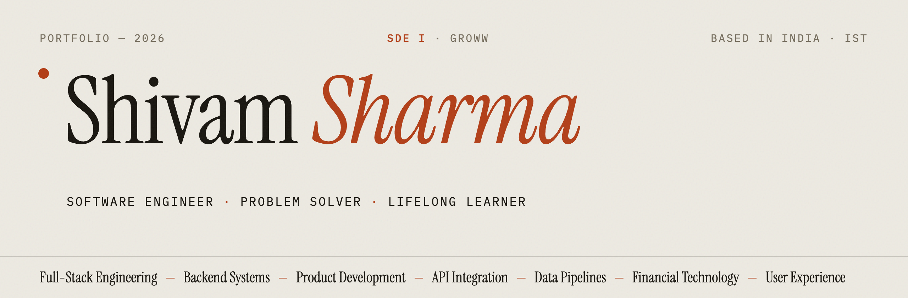
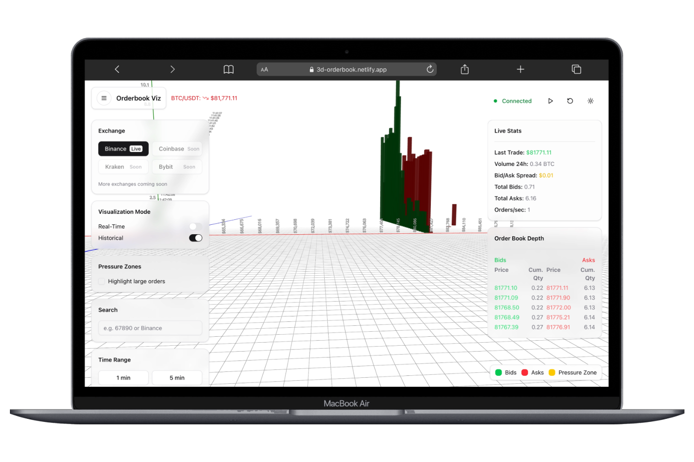
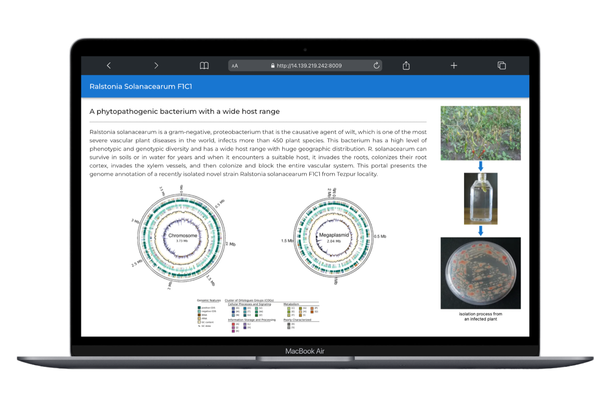
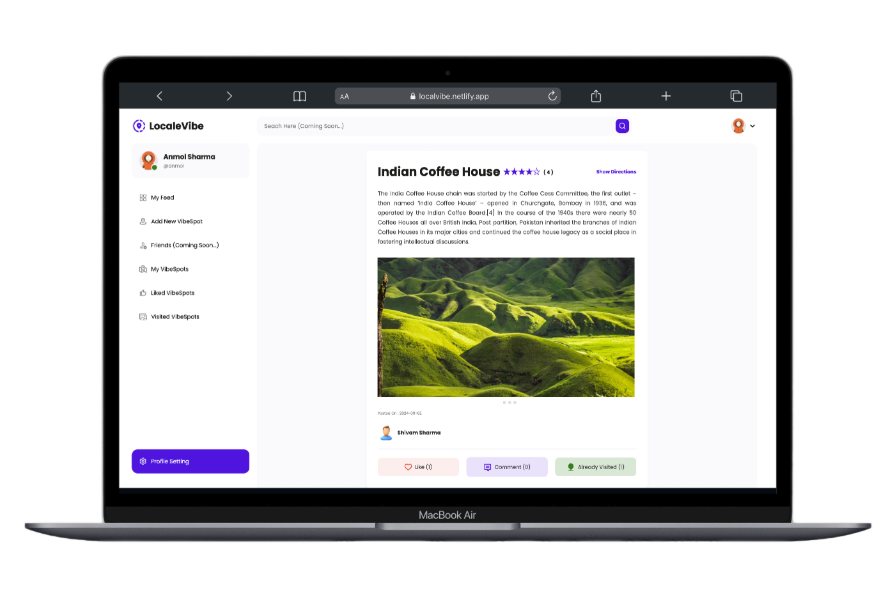
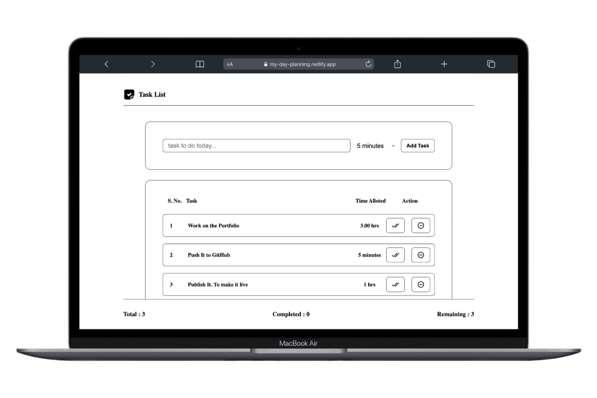
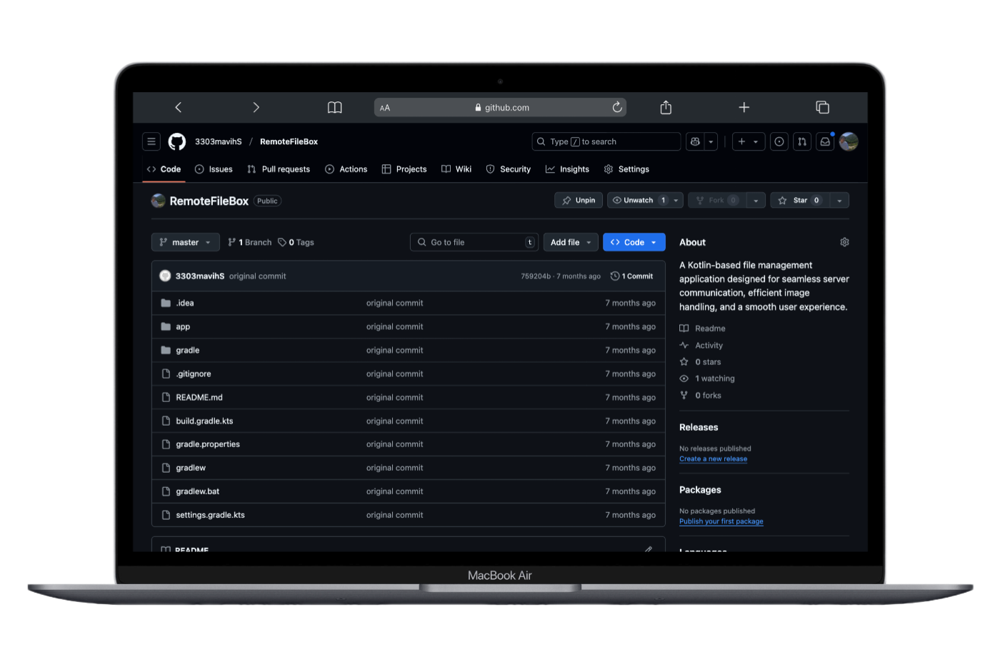
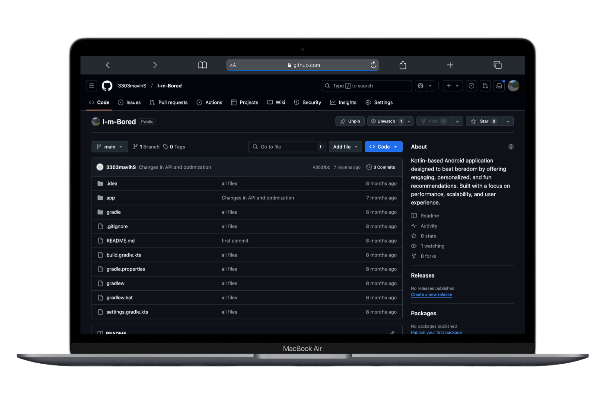

 

---

 

# 🙂 About Me

I'm a software engineer who enjoys working across the stack and figuring out how the pieces fit together. At **Groww**, I've built financial product features spanning React interfaces, Java services, database workflows, and data migration. My **MCA** (Tezpur University) gave me a stronger computer-science foundation, while my earlier business studies (**B.Com Hons**, University of Delhi) help me keep the user and the business problem in view.

I like problems that need more than just code: understanding what's broken, weighing trade-offs, and building something people can rely on. I'm looking to take broader ownership, contribute to product decisions, and help shape not just *how* we build things, but *what* we build and *why*.

- 🔹 Currently **SDE I @ Groww** — previously **SDE Intern @ Fisdom**
- 🎓 MCA · Tezpur University &nbsp;|&nbsp; B.Com (Hons) · University of Delhi
- 💡 Most at home where engineering meets business thinking
- 🌱 Always learning something new — right now: systems that scale gracefully

 

# 🚀 Featured builds

<table>
<tr>
  <td width="50%">
    
    <h3>Orderbook Depth 3D</h3>
    Crypto market depth as a live 3D landscape — Three.js · Binance/OKX APIs
  </td>
  <td width="50%">
    
    <h3>Genomic Research Portal</h3>
    3M+ base pairs on a custom Canvas genome browser — 100+ researchers
  </td>
</tr>
<tr>
  <td width="50%">
    
    <h3>LocalVibe</h3>
    Location-based social discovery with geospatial search — MERN + Leaflet
  </td>
  <td width="50%">
    
    <h3>My Day Planning</h3>
    Minimal day planner with persistent storage — React
  </td>
</tr>
<tr>
  <td width="50%">
    
    <h3>Remote FileBox</h3>
    Native Android file management — Kotlin · MVVM · Room
  </td>
  <td width="50%">
    
    <h3>I'm Bored</h3>
    Activity suggestions over REST APIs — Kotlin · Retrofit · Coroutines
  </td>
</tr>
</table>

 

# 🛠️ Toolbox

  
   
  

REST APIs · microservices · data pipelines · Kong API Gateway · Jira-driven shipping

 

# 📈 GitHub pulse

  
  

  

---

### 💬 Always up for a good conversation — code, products, ideas, or the *why* behind what we build.

**[sharmshivam23032000@gmail.com](mailto:sharmshivam23032000@gmail.com)** · **[LinkedIn](https://www.linkedin.com/in/mr-shivam-sharma/)** · **[X](https://x.com/_sharma_shivam)**

